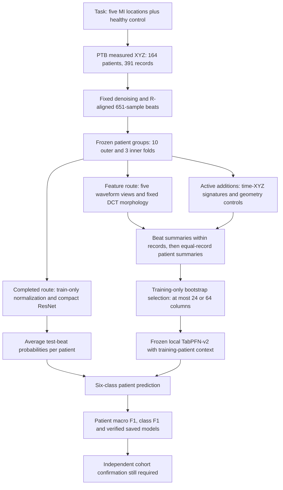

# Project pipeline: from research problem to patient prediction

Reviewed 15 November 2026. This overview separates the completed waveform benchmark from the feature-based route currently under evaluation. Read [CODEX_HANDOFF.md](CODEX_HANDOFF.md) for full history and [signature_vcg_plan.md](signature_vcg_plan.md) for the active protocol. No final signature classification score is available at this review.

Follow-up: [signature verification completed](../results/signature_vcg_v1/complete/REPORT.md) without a demonstrated gain (signature3 0.508 versus morphology 0.515). The current approved protocol is [nested 4/8/16 consecutive-beat selection](chronological_lengths_plan.md). Descriptions below of signatures as pending are retained as the earlier review's context, not current run status.

## Problem and desired solution

Given a new patient's measured Frank X/Y/Z vectorcardiogram, predict one of the dataset's six classes: anterior MI (AMI), anterior-lateral MI (ALMI), anterior-septal MI (ASMI), inferior MI (IMI), inferior-lateral MI (ILMI), or healthy control (HC). Here AMI names the dataset's anterior-location class; it is not being used as a generic abbreviation for every acute infarction.

The research objective is reliable **patient-independent localization**, measured primarily by six-class patient macro F1. Recognizing another beat from a training patient does not answer that objective. The solution currently produces a patient class and six model probabilities; those probabilities are not established clinical calibration or anatomical imaging.

The two routes are compared separately. The diagram does not describe an already trained ResNet/TabPFN ensemble. Fixed per-exam transforms can be computed without cohort fitting; every learned operation remains inside the appropriate training partition.

## Stage 1: data and signal preparation

Use the unchanged six-class cohort: **164 patients, 391 recordings, 55,863 beats**. Signals are measured XYZ at 1,000 Hz. Wavelet denoising and the established R detector produce fixed crops from R−250 to R+400 ms, giving **3 × 651** values per beat. Preserve original labels, R positions, orientation and physical amplitude. Complete-record denoising makes this an offline research pipeline.

Beats are repeated observations, not 55,863 independent patients. All recordings and beats of a patient stay in that patient's partition. [Frozen folds](../configs/patient_folds.csv) and original cohort membership remain unchanged.

## Stage 2: represent the signal

**Completed waveform route:** a compact 1D ResNet learns a 64-dimensional beat embedding directly from denoised XYZ. It has three residual stages with widths 16/32/64. Training normalization and inner stopping are fitted using training patients only. Every test beat is evaluated, and probabilities are averaged to one patient prediction. This route achieved **0.550 ± 0.040 macro F1 across three training seeds**. [Report](../results/neural_repeat_v1/REPORT.md).

**Feature route:** expose five physical waveform views: raw R, denoised D, own-record median M, beat residual D−M, and filter residual R−D. Neither residual is verified noise or pathology, and the redundant views add no new sensors. Fixed cosine coefficients summarize morphology directly from these views. They are not Tucker factors or coefficients of the wavelet-band tensor.

The broader tensor framework also constructs **beat × view × XYZ × wavelet band × time** representations for multiscale/relationship features. Many such alternatives have already been tested. A tensor is useful only if its resulting procedure improves held-out patient localization.

**Current experimental addition:** follow each denoised beat as a path `(physical time, X, Y, Z)`. Signatures summarize ordered interactions through degree two or three, with physical XYZ means retained because increment signatures lose absolute offsets. The five arms compare morphology alone, signed areas, endpoint polynomials, signature2 and signature3. The endpoint-polynomial arm is a same-size nonlinear control. Pure clock constants are excluded by mathematical schema without looking at patient values/labels. This stage has no completed performance result yet.

Mathematical background: [Chevyrev and Kormilitzin, signature-method primer](https://arxiv.org/abs/1603.03788). The use of these established methods on this task is a hypothesis, not evidence of a new SOTA architecture.

## Stage 3: aggregate features into independent patient rows

For each recording, calculate the median and IQR of every beat descriptor. For each patient, take an equal-record coordinate median. The original five-view morphology has 240 beat descriptors and **480 patient columns** after the median/IQR summaries. Signature3 adds **840 usable patient columns**, giving 1,320 before selection. Other arms have their own declared sizes.

This aggregation makes model input one row per patient and avoids treating extra beats as extra independent patients. It also discards true beat-to-beat order and some differences across recordings: a potential improvement point, not a proven cause of current errors.

## Stage 4: training-only selection and classification

Within each inner training partition, fit the established bootstrap consensus selector: 64 class-stratified patient resamples, ANOVA base ranking and correlation pruning. Keep at most 24 or 64 columns; the inner patient macro F1 chooses the budget. The 32 additional audit resamples never choose features. Scaling used for ranking is training-only.

The current classifier is pinned local **TabPFN-v2**. Its pretrained weights remain frozen; a fit supplies a labeled training-patient table, not gradient training of the foundation model. It receives raw selected columns and fits its own preprocessing to that training context. Inference uses eight fixed members and raw probabilities, with no inverse-prior correction or online prediction service.

The current study varies feature-selection sampling seeds 42/123/2026 while keeping the PFN inference-seed policy fixed. It comprises 1,050 fitted contexts and 150 outer arm/seed evaluations. These repeats are not independent cohorts. [Protocol](signature_vcg_plan.md).

## Stage 5: evaluate, verify and decide

Use three inner folds to select/stabilize training choices, then freshly fit on all outer-training patients and predict the untouched outer-test patients. Repeat for all ten outer folds. Pool patient predictions, report macro F1, every class F1, accuracy, all declared seeds, and descriptive paired differences against matched controls. MI-only analysis retains six-way predictions, so an MI patient predicted HC remains an error.

Independent report code checks cached membership/probabilities, replays selection and restores saved outer models. Partial folds, selected inner scores and reconstruction audits do not establish improvement. These repeatedly inspected PTB folds remain development data; verification does not turn them into a new independent cohort.

Current evidence anchors:

| Procedure | Macro F1 | Meaning |
|---|---:|---|
| Presentation's nested statistics/XGBoost | 0.487 | Historical feature benchmark |
| Waveform ResNet | 0.550 ± 0.040 | Completed three-training-seed reference |
| Previous raw TabPFN feature procedure | 0.542 | Completed, one fixed inference/selection policy; different from the current arm grid |
| Healthy-reference features | 0.479 ± 0.034 | Completed; no gain over its matched ensemble at 0.499 ± 0.019 |
| Ordered-signature study | Pending | Active controlled comparison; no complete score |

Do not combine these rows into a claim that every later experiment improved the model. A new procedure should first beat its own fresh matched control. External confirmation remains unresolved.

## Where improvement can come from

| Pipeline stage | Specific hypothesis | Fair experiment / limitation |
|---|---|---|
| Representation, current priority | Ordered XYZ interactions help separate MI subtypes | Finish signatures versus signed areas, endpoint polynomials and morphology. Report every seed; do not expand the search based on a partial fold. |
| Aggregation, next structural candidate | Contiguous within-record beats plus RR timing help beyond unordered summaries | Small chronological model against a shuffled-order control, using the same records/budget. Prior unordered bags already failed; do not rename them as chronology. |
| Feature selection | Univariate base ranking may discard features useful jointly | A new, bounded comparison of selection or train-only joint compression, preserving the same outer folds and tuning budget. Extra retained energy alone is not diagnostic improvement. |
| Model combination | Waveform and tensor models make complementary errors | First audit error overlap, then rebuild base models and learn any combination using only the relevant outer-training patients. Do not tune weights on pooled outer predictions. |
| Data/generalization | More independent, label-compatible measured-VCG patients improve transfer | Seek a compatible cohort and qualified adjudication. Derived XYZ differs from measured Frank XYZ; source–target identity/label compatibility must be established. More beats from the same patients do not solve this. |

The weak classes and recurring confusions should guide hypotheses: AMI/ALMI remain substantially below healthy-control F1, and IMI↔ILMI and AMI/ALMI/ASMI errors recur. New methods should help actual subtype localization, not only HC recognition. A small confusion-specialist model is a later hypothesis, not implemented work.

The next defensible milestone is a repeatable gain over the active study's matched control, followed by independent cohort evidence. A score target does not justify changing cohort membership, labels, patient splits or the primary macro-F1 endpoint.
