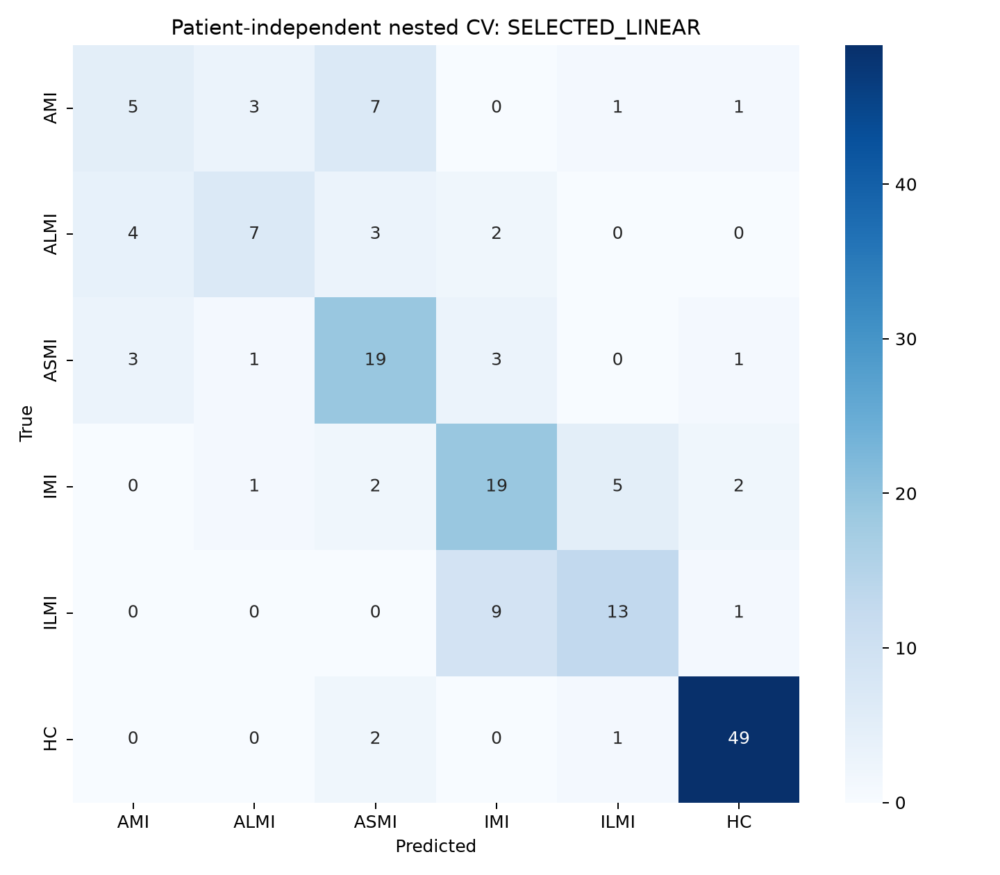
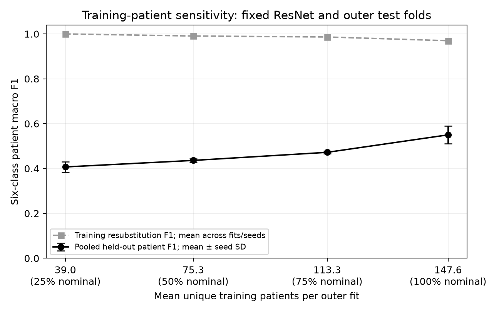

# Can measured Frank VCG localize infarction in an unseen patient?

Research and code audit, 18 November 2026. Evidence snapshot through Git commit `da96b2ca`. Prepared for the NIT Goa major project. All proposals below await a research decision. The audit ran on CPU, read the existing evidence and fitted zero models.

## A. Executive research assessment

**The team has improved six-class patient macro F1 from 0.4027 to approximately 0.60 on the same 164 PTB patients.** Replaying the original XGBoost and selected-convolution predictions gives a paired difference of **+0.2006**, with a descriptive 95% patient-bootstrap interval **[+0.1122, +0.2902]**. The waveform ensemble independently uses a different representation and reaches **0.6018** on those same people. Data reuse across many research decisions limits how well the highest observed score predicts performance at another hospital. [Original benchmark](../BENCHMARK_RESULTS.md) · [Prediction bank comparison](../results/model_error_comparison_v1/REPORT.md) · [Read-only reproduction](../scripts/audit_patient_evidence.py)

**The most consequential modeling question is which examination should support a diagnosis.** The current protocol produces one answer after aggregating all eligible recordings for each person. In a new read-only diagnostic, 57 of the 93 people with multiple recordings received different top labels across recordings from the same frozen waveform ensemble. Giving each patient one uniformly selected examination yields 0.5683 macro F1 computed from the expected confusion counts, compared with 0.6018 using all their beats. That difference warrants checking acquisition dates, disease evolution and recording quality before imposing a loss that forces visits to agree. [Diagnostic method](../scripts/audit_patient_evidence.py) · [Waveform aggregation](../src/mi_localization/benchmark.py#L143)

**Prioritize a blinded review and additional independently labeled measured XYZ patients.** Of 52 convolution errors, 44 exchange one MI subtype for another. Existing data support a real improvement, a challenging endpoint and a positive patient learning curve. They do not establish a statistical ceiling or an achievable 0.80–0.90. The most useful current-cohort experiment is a fixed index-exam sensitivity analysis. The highest-value new-data experiment is a controlled learning curve with separately reserved external patients. [Error budget](path_to_080_macro_f1.md) · [Learning curve](../results/neural_learning_curve_v1/complete/REPORT.md) · [Advisor brief](measured_vcg_advisor_brief.md)

**Scope of verification.** The snapshot contains 145 tracked Python files under the project package including vendored code, 61 YAML configurations, 77 Markdown files under docs, 63 tracked result reports named REPORT.md, 62 tracked test modules/files under tests matching *.py, and no tracked Jupyter notebooks. I inventoried the repository, history, presentations and reports, traced the data and decision paths behind the headline results, read both supplied papers, and checked the local original data and saved outputs as described in D. Earlier experiment restorations cited below are the repository's recorded verifications. This audit did not retrain those studies, reread every line of every historical module, validate every plot, or independently adjudicate a diagnosis. Some early tracked outputs include patient-level predictions. New audit output contains only aggregates. [Handoff](CODEX_HANDOFF.md) · [Project inventory](../scripts/project_status.py) · [Study register](RESEARCH_BACKLOG.md)

## B. Reconstructed research history

Dates refer to stages of development. F1 values below use patients unless the row identifies another unit. “Mean member” averages three separate F1 scores. “Ensemble” averages three vectors of scores first, makes one decision per patient, then computes one macro F1. These estimands can differ substantially.

| Stage | Question, result and interpretation | Repository evidence |
|---|---|---|
| 20 Sep · paper reproduction | 178 people, 425 records and 60,507 beats across 12 classes, close to 60,527 published beats. Random beat folds gave 99.136% accuracy and .9908 beat macro F1 with 177–178 shared patients per fold. Grouping the same reproduction by patient gave 41.385% beat accuracy and .1908 beat macro F1. Several rare categories had only one person. | [Reproduction](../RESULTS.md) · [CV implementation](../src/mi_localization/evaluation.py#L36) |
| 20–21 Sep · viable six-class endpoint | Kept the five MI subtypes with adequate patient support plus HC. Majority .0802, linear SVM .3661, RF .3797, Tucker/XGBoost .4027. Twelve matched representation ablations identified wavelet statistics. Nested XGBoost with these 192 features achieved .487 versus .403, paired difference +.084 [.003,.165]. The representation was nominated after inspecting ablations on this cohort. | [Benchmark](../BENCHMARK_RESULTS.md) · [Ablations](../ABLATION_RESULTS.md) |
| Sep–Oct · transport and presentation | The earlier wavelet-statistics model reached .242 on a strict 1,092-person PTB-XL fold-10 mapping using derived XYZ. Within PTB, measured→measured .469, measured→derived .422 and derived→derived .467 under a fixed protocol. The October presentation's strongest nested score was .487. External labels, case mix, signal duration and acquisition all changed. | [External test](../EXTERNAL_RESULTS.md) · [Domain study](../DOMAIN_SHIFT_RESULTS.md) · [Presentation notes](implementation_presentation_notes.md) |
| Oct–12 Nov · correlation tensors and waveform learning | Train-only shared correlation cores .413 and covariance cores .470 versus short-beat statistics .469. A compact denoised XYZ ResNet reached .586 on seed 42. The three-seed rerun gave .586/.557/.507, mean .550 ± .040. Learned waveform morphology helped relative to the earlier feature baseline, with substantial seed dependence. | [Relational comparison](../results/relational_vcg_v1/complete/REPORT.md) · [Neural repeat](../results/neural_repeat_v1/REPORT.md) |
| 13–15 Nov · neural representations and data quality | Unordered bags/attention/learned Tucker, two cross-patient supervised contrastive designs, raw inputs, longer crops, gain/noise, dropout/weight decay, phase geometry, class-name territory targets and paired ECG+VCG did not establish a reliable advance. Training-size curve .407/.436/.472/.550 at approximately 39/75/113/148 training patients. Five physical views and tensor banks passed reconstruction checks. Strict adaptive phase boundaries supported only about 23.2% of beats. | [Patient tensor](../results/neural_patient_tensor_v1/complete/REPORT.md) · [Contrastive](../results/neural_contrastive_diverse_v1/complete/REPORT.md) · [Geometry](../results/neural_geometry_v1/complete/REPORT.md) · [Learning curve](../results/neural_learning_curve_v1/complete/REPORT.md) · [Handoff evidence table](CODEX_HANDOFF.md) |
| 15–16 Nov · feature selection and references | Higher DCT fidelity did not reliably improve classification. Bootstrap feature consensus helped the shallow tree .420→.513. Raw local TabPFN reached .542. Healthy-reference deviations .479 versus .499, and third-order path signatures .508 versus morphology .515. Stable reconstruction, extra geometry and better downstream discrimination were separate outcomes. | [Refinement](../results/tensor_refinement_v1/complete/REPORT.md) · [Consensus](../results/feature_stability_v1/complete/REPORT.md) · [PFN](../results/tabpfn_v2_v1/complete/REPORT.md) · [Deviation](../results/deviation_vcg_v1/complete/REPORT.md) · [Signature](../results/signature_vcg_v1/complete/REPORT.md) |
| 16 Nov · chronology and fusion | Nested 4/8/16 consecutive beats with RR .524 mean versus shuffled .533. Direct residual context also failed its mean-member comparison. Post-hoc equal-seed residual ensemble .584570 versus matched beat-only .545112, interval for gain crossed zero. Staged learning often chose zero adaptation. Simple or inner-selected neural/tensor fusion did not improve the neural ensemble. Older separate multiview sweep is paused. | [Chronology](../results/neural_chronological_lengths_v1/complete/REPORT.md) · [Residual ensemble](../results/neural_residual_seed_ensemble_v1/complete/REPORT.md) · [Staged](../results/neural_staged_context_v1/complete/REPORT.md) · [Fusion](../results/neural_tensor_fusion_v1/complete/REPORT.md) |
| 16–18 Nov · convolution and distributions | Recording-median MultiRocket-style + HYDRA + ridge gave .584266 versus matched DCT .445781, **+.138485 [.047546,.228367]**. Selected ridge/PFN fell to .544/.531. Handcrafted distribution quantiles .487 versus moments .476. Adding spread to the intact convolution base gave .594098, quantiles .589485. A shared inner representation selector gave linear .603374 and nonlinear .583933. Frozen learned quantiles .580895 and additive score correction .584266 failed to advance the reference. | [Rocket](../results/rocket_vcg_v1/complete/REPORT.md) · [Selected PFN](../results/rocket_tabpfn_v1/complete/REPORT.md) · [All-beat](../results/convolution_distribution_v1/complete/REPORT.md) · [Kernels](../results/distribution_kernel_v1/complete/REPORT.md) · [Learned](learned_distribution_findings.md) · [Correction](distribution_score_correction_findings.md) |
| 16–18 Nov · external/native source experiments | PTB-XL masked and supervised pilots, recording-copy screens and matched transfer. Certain-label supervised ensemble .573361 vs its matched scratch .538736, uncertain. In the later fixed-eight-epoch design, scratch .601801, native expanded pretraining .518364, ECG-assisted paired bridge .564293. Native partial header mentions .575887 vs shuffled .568947. ACS-ECG OMI+artery .580730 and STAFF III paired-change .539589 also fell short of .601801. STAFF III source vessel macro F1 rose .541→.772 in 15 validation patients, illustrating the difference between source learning and target benefit. | [PTB-XL transfer](supervised_transfer_findings.md) · [Native/bridge](vcg_pretraining_pilots_findings.md) · [Partial labels](native_partial_labels_findings.md) · [ACS](../results/neural_acs_artery_transfer_v1/complete/REPORT.md) · [STAFF III](../results/neural_staffiii_pair_transfer_v1/complete/REPORT.md) |
| 18 Nov · targeted tests at the plateau | Subtype graph .591424 vs .584266, uncertain. Local timing failed its feasibility gate and never produced a classifier score. Signed lag tensor .531364 vs .584266. Average of four convolution readouts .586053. Equal waveform/convolution blend .582209. Patient CE in grouped batches .469596 vs matched beat CE .510134. R-relative pooling .577238, shuffled .577459. Hierarchical MI/HC × subtype logistic .586828 vs flat .562819, difference +.0240 [−.0012,+.0561]. | [Backlog with evidence links](RESEARCH_BACKLOG.md) · [Readout averaging](../results/convolution_readout_average_v1/REPORT.md) · [Patient loss](../results/neural_patient_probability_loss_v1/complete/REPORT.md) · [Subtype hierarchy](../results/probabilistic_subtype_v1/complete/REPORT.md) |

The best-supported improvements are richer subband statistics over the early Tucker representation and richer random-convolution morphology over matched DCT. Comparable patient scores from a second waveform pipeline support the importance of morphology. The total +.2006 also includes different classifiers, aggregation, regularization, ensembling and retrospective choice of research procedures. The studies do not identify an additive causal contribution for each of those changes. The .603374 result came from the linear control in a nonlinear study. Its average member scored .562847. [Kernel comparison](../results/distribution_kernel_v1/complete/REPORT.md)

## C. Data-to-prediction workflow

1. **Define the target.** PTB Diagnostic ECG Database v1.0.0 has simultaneous 12-lead ECG and measured Frank XYZ. The primary tracks use signed physical VX/VY/VZ at 1 kHz. The patient directory links visits. The parser reads healthy-control or MI admission/diagnosis plus **acute infarction location** in the clinical header, normalizes spellings and maps territories. Former MI is stored for review. AMI specifically means *anterior* MI here. The endpoint is single-label agreement with the source clinical summary. Other illnesses, ambiguous and underrepresented subtypes are outside this six-way evaluation. The denominator is 164 eligible people, including 52 healthy volunteers, rather than all people presenting with suspected MI. [Dataset](https://physionet.org/content/ptbdb/1.0.0/) · [Header parsing](../src/mi_localization/labels.py#L85) · [Manifest and waveform loading](../src/mi_localization/data.py#L43)
2. **Prepare each examination independently.** Wavelet denoising with bior6.8, fixed peak detector and inclusive R−250 through R+400 ms windows give three signed channels × 651 samples. Preserve physical orientation, amplitude differences and cached R indices. Denoising and record medians use the complete recording. The 12-class reproduction tensor is lead × time × 8 slices, with time rank 3 giving 72 coefficients per beat. Its per-beat decomposition does not fit a population basis. Later learned/shared bases require fold-specific fitting. [Detector/config](../configs/paper.yaml) · [Signal operations](../src/mi_localization/signal.py#L10) · [Tensor operations](../src/mi_localization/features.py#L23)
3. **Convolution route.** Each recording supplies a coordinate median of all original denoised beats. Train-only RMS scaling, random convolution filters/biases and competing-filter counts produce the 3,584-column combined base. Average record features equally within a patient. The selector also considers the base with mean, spread or projected quantile summaries of beat residuals. Class-balanced ridge uses alpha 1 or 100. Each family selects its penalty inside three inner folds. Both families share the representation maximizing their average best inner scores. At inference, fixed-temperature softmax converts member scores and the three transform-seed vectors are averaged. This exact selection rule is part of the .603374 model. [Templates](../src/mi_localization/rocket_bank.py#L25) · [RMS, filters and pooling](../src/mi_localization/rocket_features.py#L118) · [Fit and scaler](../src/mi_localization/rocket_study.py#L92) · [Selector](../src/mi_localization/distribution_kernel_study.py#L127) · [Protocol](../configs/distribution_kernel_v1.yaml)
4. **Waveform route.** Compact 1-D residual stages of widths 16/32/64, four temporal pooling bins, 64-dimensional embedding and six-way output. Fit channel means/scales only on training beats with balanced class/patient weights. Sample training beats with replacement using these weights. For the .601801 scratch reference use cross-entropy, AdamW, fixed LR .001, weight decay .01, dropout .2, batch 128, 2,048 presentations per epoch, eight epochs and gradient clipping at norm 5. In the older .550 mean study, the training budget was 8,192 presentations/epoch and the inner validation selected stopping. For the newer ensemble, average probabilities over all eligible beats for each patient, then over seeds. More beats from a recording contribute more to that patient's decision. The primary neural model requires no ECG input or source encoder. [Architecture](../src/mi_localization/neural.py#L186) · [Actual waveform trainer](../src/mi_localization/preprocessing_study.py#L54) · [Fixed-budget config](../configs/vcg_pretraining_pilots_v1.yaml) · [Historical training curve protocol](diagnostics_learning_curve_plan.md)
5. **Make one decision and score it.** Use six-way argmax. For each class, F1 = 2TP/(2TP+FP+FN), with a zero contribution for an undefined denominator. Average the six class F1 values equally on the pooled out-of-fold patients. Micro F1 equals accuracy here. Weighted F1 gives more influence to larger classes. There is no tuned operating threshold in either headline system. A separate binary MI/HC result cannot replace localization. [Patient pooling and metrics](../src/mi_localization/benchmark.py#L143) · [Verified ensemble reconstruction](../src/mi_localization/model_error_comparison.py#L155)

## D. Leakage, evaluation and reproducibility audit

| Question | Finding and remaining uncertainty |
|---|---|
| Does a patient occur on both sides of an evaluated fit? | **Verified for the headline convolution study by PTB identifier.** Rebuilt the ten outer and thirty inner membership pairs from frozen folds and train-only stratification. Checked receipt hashes, both membership hashes and training-label hashes across **2,160 inner and 240 outer fit receipts**. Independently replayed saved predictions from both leading models, including the waveform train/query beat-row hashes, all three seeds, 180 source artifacts and 30 waveform checkpoint hashes. No membership violations found. [Read-only auditor](../scripts/audit_patient_evidence.py) · [Patient split construction](../src/mi_localization/benchmark.py#L58) |
| Can repeated beats/visits cross a boundary? | Re-read all 391 target headers. Labels and parent directories matched the beat table. One patient and one label per record, no repeated R index in the same record, 391 distinct encoded XYZ hashes. Adjacent 651-sample windows can overlap *within* an exam. A record and all of its windows inherit the same patient fold. Whole-file hashing cannot detect a re-encoded or partial copy, or two identifiers for one person. The main accuracy target also assumes all visits are available. [Raw-data checks](../scripts/audit_patient_evidence.py) · [Earlier diagnostics](../results/neural_diagnostics_v1/REPORT.md) |
| Could preprocessing or augmentation learn from query rows? | Record-local transforms are offline and label-free. Core feature scalers, filter bias quantiles, class weights, kernel centering and bandwidth are fitted with training rows. The waveform normalizer consumes training indices. The tested gain/noise augmentation occurs on sampled training beats after fitting the normalizer. No synthetic patients enter either headline estimator. One important historical dependency is the original detector threshold 0.06 chosen to approximate the paper's aggregate beat count on this database. Freeze and independently validate this detector for new cohorts. This is cohort-informed preprocessing, without evidence that outer F1 selected the threshold. [Detector choice](../configs/paper.yaml#L16) · [Kernel fitting](../src/mi_localization/distribution_kernel_model.py#L10) · [Waveform normalization](../src/mi_localization/neural.py#L126) · [Augmentation design](../results/neural_regularization_v1/complete/REPORT.md) |
| Could source teachers, feature selection or caches leak a split? | Leading linear model reuses exact-partition feature banks with source hash checks. Historical raw→feature restorations and kernel equivalence checks are inherited evidence. In a separate learned-distribution study, inner teachers used their own validation patients to choose stopping. Its inner feature scores are selection-dependent. In the probabilistic subtype study, the chosen representation already reflects the same inner folds used for subsequent penalty selection. Neither pathway supplies independent validation within those inner folds. Outer patients stayed out of that selection. For a learned calibrator/stacker, cross-fit the *entire* base selection within each meta-training partition. [Source validation](../src/mi_localization/distribution_kernel_source.py#L46) · [Teacher disclosure](learned_distribution_findings.md) · [Subtype selection](../src/mi_localization/probabilistic_subtype.py#L137) |
| Are labels or patient IDs supplied as predictors? | IDs group and balance observations. Clinical text defines the target. The inspected headline forward inputs are waveforms or their derived features. Header diagnosis, IDs and filenames do not enter those forward paths. However, exam count differs by class and averaging can change noise levels with exam count. Age, sex, timing, treatment and acquisition effects were not controlled through a multisite design. Header consistency tests parsing, not clinical correctness. [Trainer inputs](../src/mi_localization/preprocessing_study.py#L54) · [Template input](../src/mi_localization/rocket_bank.py#L25) |
| Is there temporal leakage? | The documented estimand is retrospective classification from a patient's available complete records. Future samples within a record and later visits would be unavailable for an admission-time or streaming decision. An index-exam analysis needs source dates verified independently of predictions, explicit handling of ties/missing dates and an origin time. No prognostic or time-to-event conclusion follows. [Cohort and inference](PIPELINE_OVERVIEW.md) · [New aggregation check](../scripts/audit_patient_evidence.py) |
| Is the test set untouched? | **No untouched six-class measured-XYZ test cohort was identified.** Outer patients are isolated within each fit, but their aggregated outcomes have influenced subsequent hypotheses repeatedly. The strongest historical point can be optimistic. Copy screens with positive controls reduce a specific source/target recording-duplication risk. They cannot certify cross-dataset patient identity. The old PTB-XL fold-10 test addresses a different acquisition and was already inspected. [Overlap audit](../results/supervised_source_overlap_v1/REPORT.md) · [External protocol](../EXTERNAL_RESULTS.md) · [Partner intake](measured_vcg_partner_cohort.md) |

**Which split to use.** Continue the frozen ten stratified patient folds and, for learned decisions, three inner patient folds. Applying StratifiedKFold to *one row per uniquely labeled patient*, then expanding IDs back to records, implements the required grouping. StratifiedGroupKFold on beat rows can aim for beat balance and yield different patient class counts. Leave-one-patient-out would train on 163 people but would require 164 outer fits per configuration, single-patient folds cannot estimate six-class F1 in isolation, and the reused patients would still be development data. Pool predictions if doing that as a sensitivity analysis. A fresh randomized split of these patients cannot make them untouched again. A prospectively locked external cohort or site, with all six classes and a predeclared label policy, is the appropriate confirmation. [Frozen assignments](../configs/patient_folds.csv) · [Inner implementation](../src/mi_localization/benchmark.py#L157) · [Partner protocol](measured_vcg_partner_cohort.md)

### What is reproducible about 0.60?

| Patient statistic, replayed | Convolution | Waveform |
|---|---:|---:|
| Ensemble macro F1 | .603374 | .601801 |
| 95% descriptive stratified patient interval | [.5219,.6785] | [.5191,.6791] |
| Accuracy / micro F1 | .6829 | .6646 |
| Member F1 for 42, 123, 2026 | .5436, .5787, .5663 | .5931, .5426, .4887 |
| Outer fold F1, folds 1–5 | .595, .336, .608, .576, .754 | .463, .595, .516, .484, .517 |
| Outer fold F1, folds 6–10 | .694, .571, .729, .533, .452 | .778, .554, .717, .417, .593 |
| Paired gain over original Tucker/XGB | +.2006 [.1122,.2902] | +.1991 [.1008,.2982] |
| Mean top probability / observed correctness | .381 / .683 | .583 / .665 |
| Patient log loss / multiclass Brier, summed across classes | 1.228 / .587 | .939 / .487 |

These are point-reproducible on this checkout. Fold scores are noisy with only 16–17 people in each fold. Changing the patient partition changes both training and testing composition. This audit did not fit alternate outer splits. The intervals use 5,000 class-stratified patient resamples, seed 42 and the same draws for both models. They condition on fixed predictions and class counts, excluding refit, site and research-selection uncertainty. Waveform minus convolution is −.001573 [−.085967,+.080816]. Do not run a t-test treating folds, seeds or beats as independent. A prespecified paired patient bootstrap on a new locked cohort, plus class supports and confusion counts, is appropriate. Where several sites are available, report per-site results and site-level variation. [Reproduction script](../scripts/audit_patient_evidence.py) · [Paired comparison](../results/model_error_comparison_v1/REPORT.md) · [Bootstrap implementation](../src/mi_localization/residual_context_report.py#L25)

| Class | Patients / records | Single-record patients | Convolution precision / recall / F1 | Waveform precision / recall / F1 |
|---|---:|---:|---:|---:|
| Anterior MI | 17 / 47 | 5 | .417 / .294 / .345 | .529 / .529 / .529 |
| Anterolateral MI | 16 / 43 | 5 | .583 / .438 / .500 | .500 / .375 / .429 |
| Anteroseptal MI | 27 / 77 | 6 | .576 / .704 / .633 | .621 / .667 / .643 |
| Inferior MI | 29 / 88 | 7 | .576 / .655 / .613 | .556 / .517 / .536 |
| Inferolateral MI | 23 / 56 | 10 | .650 / .565 / .605 | .583 / .609 / .596 |
| Healthy control | 52 / 80 | 38 | .907 / .942 / .925 | .855 / .904 / .879 |



The marked gap between confidence and correctness, particularly in ridge softmax, makes confidence-based fusion risky. A single positive temperature applied to the final ensemble logits preserves argmax, so it cannot improve that ensemble's classification F1 by itself. Calibration can still improve probability quality. Its validation endpoint should be log loss, Brier score and reliability, with F1 reported separately. [Fixed-score replay](../scripts/audit_patient_evidence.py) · [Ensemble fusion results](../results/model_error_comparison_v1/REPORT.md)

## E. Why performance is around 0.60

Ranks are research judgments. Available data cannot assign percentages of error to each cause.

1. **Few independent labeled examples for fine distinctions — strongest evidence.** Only 16–29 people represent each MI subtype. A single change moves anterior recall by 1/17. Convolution confuses 7 anterior cases with anteroseptal and 9 inferolateral with inferior. The existing waveform size experiment moved mean member F1 from .472 to .550 between about 113 and 148 training patients, paired difference +.078 [.028,.130]. Full-size training resubstitution F1 was .970. The gap supports a generalization limitation under that recipe. Only one subset draw per fold was used. [Confusion matrix](../results/distribution_kernel_v1/complete/confusion_patient_selected_linear.csv) · [Controlled curve](../results/neural_learning_curve_v1/complete/REPORT.md)
2. **Variable evidence across visits and possible endpoint ambiguity — partly verified.** A single recording is available for 38/52 controls and 33/112 people with MI. The number of beats per patient ranges from 39 to 973. To isolate visit availability at inference, we averaged the three held-out waveform members within each record, then gave every patient's records total weight one. For each patient we distributed one count uniformly over that person's record predictions. The resulting expected confusion matrix gives .6301 accuracy and .5683 macro F1. F1 of expected counts differs mathematically from the mean F1 across random visit assignments. The all-beat/reference values are .6646 and .6018. Different recordings disagree in 57/93 multi-record people. As a timing feasibility check, 385/391 headers contain a numeric slash-form ECG date. The first field exceeds 12 in 269 records, the second in zero, and both fields are at most 12 in 116. Six headers have no usable date text. Of the 93 multi-record patients, 82 have different date strings across their records. A date string alone cannot distinguish exams acquired on the same day or establish time since infarction. This analysis does not identify which visit is clinically representative, nor prove that a label is wrong. [Diagnostic](../scripts/audit_patient_evidence.py) · [Existing unadjudicated error review](../results/neural_diagnostics_v1/REPORT.md)
3. **Mismatch between added supervision and target information — demonstrated for tested procedures.** More ECG-derived waveforms, vessel labels, ischemic perturbations, self-supervised masking and extra native records all tested different hypotheses. Better source-task metrics did not reliably yield better PTB subtype decisions. The 0.242 external result concerns the earlier statistics classifier. The .60 models do not yet have a real measured-XYZ external score. [Source/target evidence](staffiii_pair_transfer_plan.md) · [External evidence and label mapping](../EXTERNAL_RESULTS.md)
4. **Representation and estimation variability — supported, effect size unresolved.** Preserving absolute orientation, multiscale content and patient-balanced morphology helped. Per-beat vector normalization reduced the early fixed-tree F1 from .416 to .369. Higher Tucker rank, empirical tails, geometry and additional order features supplied little matched improvement. Ensemble gains over individual seeds are material. The two current leaders both miss 36 patients, with 21 identical wrong labels. A truth-aware retrospective chooser between their two existing top labels can reach at most .736055 on these predictions. This bound applies only to that restricted routing problem. [Ablations](../ABLATION_RESULTS.md) · [Representation comparisons](distribution_kernel_findings.md) · [Exact restricted bound](path_to_080_macro_f1.md)
5. **Optimization / decision rule — secondary, worth a small control.** In the 30 eight-epoch scratch checkpoints, mean training CE fell from 1.674 to .585. Gradient norms before clipping were not logged. The fixed schedule provides no independent estimate of an optimal epoch. Earlier longer/inner-stopped models, bounded regularization and class/patient-balanced training already exist. Changing eight-beat grouped presentation lowered the matched beat-CE reference to .510. Broad optimizer sweeps would confound exposure, stopping and objective. The strongest model already fits a regularized linear head. [Waveform training histories replay](../scripts/audit_patient_evidence.py) · [Regularization](../results/neural_regularization_v1/complete/REPORT.md) · [Grouped loss control](../results/neural_patient_probability_loss_v1/complete/REPORT.md)



**Unresolved.** Site/device-specific shortcuts, event-to-exam delays, treatment effects, independently confirmed extent of each infarct, subgroup transport, reference-label reliability and near-copy identity risk remain incompletely measured. Persistent cases are descriptive. Counts from an error-enriched packet cannot estimate a population label-error rate. [Clinical review scope](diagnostics_learning_curve_plan.md) · [Partner label policy](measured_vcg_partner_cohort.md)

## F. Focused literature review

I searched for PTB inter-patient MI localization, measured orthogonal leads, label-compatible external data, the supplied tensor methods, and patient-disjoint representation learning. This is a targeted primary-source review. For comparison, a paper would need to match the modality, six labels, patient inclusion, independent split, aggregation unit and F1 definition. None of the studies below supplies that complete comparison.

| Primary study | People, design, metric and patient independence | What transfers, and what remains uncertain |
|---|---|---|
| Jieshuo Zhang et al., 2023, *Automated Localization of Myocardial Infarction From Vectorcardiographic via Tensor Decomposition* | PTB, 126 MI + 52 HC. Measured XYZ, wavelet–Tucker and TreeBagger, tenfold evaluation on 60,527 beats. 99.80% multiclass beat accuracy. Results text gives overall F1 .9999, conclusion .9998. Their definitions use beats and normal beats as negatives for overall measures. The authors explicitly leave inter-patient validation for future work. | An appropriate reconstruction target. Our reproduction measures actual overlap under its random beat split. The published article does not supply patient memberships that would allow independently counting overlap in the authors' run. Our grouped patient endpoint is stronger for the unseen-patient question. [IEEE paper](https://doi.org/10.1109/TBME.2022.3202962) |
| Wenhan Liu, Jiewei Ji, Sheng Chang, Hao Wang, Jin He and Qijun Huang, 2022, *EvoMBN: Evolving Multi-Branch Networks on Myocardial Infarction Diagnosis Using 12-Lead Electrocardiograms* | PTB pool includes 148 MI and 52 HC people before the subtype restrictions. Exact retained six-class unique-patient count was not established here. Fivefold inter-patient evaluation as reported. Lead-specific CNN branches, lead attention and genetic architecture search. Six similar classes. Their group of binary classifiers reached **.694 mean of class F1 values** vs .569 for the single multiclass model, with confusion counted across held-out **beats**. | Closest class set and a reason to test a modest binary-head control. Twelve ECG leads, beat normalization and beat-weighted counts differ from our model. Outer-independence of every architecture fitness decision could not be independently verified. A .694 versus .603 ranking would be invalid. [Full paper, §§2–3 and Tables 1–2](https://www.mdpi.com/2079-6374/12/1/15/pdf?version=1640830148) |
| Xinyue Li, Yangcheng Huang, Yixin Ning, Mingjie Wang and Wenjie Cai, 2024, *Multi-branch myocardial infarction detection and localization framework based on multi-instance learning and domain knowledge* | PTB and PTB-XL, inter-patient protocol as reported. MFB-SENET detects MI and MFB-DMIL localizes using lead-dependent features, attention and lead loss. Localization accuracy 67.17% on PTB and 85.83% on PTB-XL. The accessible primary abstract does not specify analyzed patient counts, localization F1 averaging or all tuning partitions. | Supports separating detection from territorial discrimination. The project already tested MIL and a probabilistic detection/localization hierarchy. Twelve-lead anatomical priors cannot simply be assigned to three Frank axes. It supplies no six-class patient macro F1 benchmark here. [Primary abstract](https://pubmed.ncbi.nlm.nih.gov/38599223/) |
| Ankita Shukla and Muhammed Izharuddin, 2026, *Inter-Patient Multi-Label Localization of Myocardial Infarction Territories Using 12-Lead ECG Signals* | PTB-XL, paper lists 18,885 people in the source database, eligible subgroup counts need separate verification. Reported patient-disjoint setup, MobileECGNet depthwise convolutions and attention, focal BCE and validation-tuned per-label thresholds. Four nonexclusive territories, macro F1 .5800, anterior F1 .90 and lateral .12. | Useful evidence that the most difficult region and meaning of an F1 of .90 depend on the labels. Overlapping region targets could be useful **if independently evidenced**. Patient pooling comparable to ours and fold memberships were not independently verified. [Publisher paper, Tables I–V](https://www.etasr.com/index.php/ETASR/article/download/19707/6942/98750) |
| Naimahmed Nesaragi, Shivnarayan Patidar and Veerakumar Thangaraj, 2021, *A correlation matrix-based tensor decomposition method for early prediction of sepsis from clinical data* | PhysioNet 2019 cohorts A/B, 40,336 patients. 24 clinical variables, rolling six-hour correlations, Tucker core and LightGBM with Bayesian search. Reports patient-wise stratified fivefold evaluation plus cross-cohort utility. Table 3 mean binary sepsis F1 **.1307**, AUROC .8613, normalized utility .4314. Prediction unit is time-indexed clinical risk. | Motivated our completed relational tensor comparison. The paper describes pooled global imputation and CV-based tuning. Full training-only nesting of those operations is unclear. Three signed XYZ leads offer different relationships from 24 clinical variables. Repeating the same correlation core has low priority given .413/.470 on PTB. [Publisher paper](https://www.sciencedirect.com/science/article/abs/pii/S0208521621000851) · [Our matched test](../results/relational_vcg_v1/complete/REPORT.md) |
| Dani Kiyasseh, Tingting Zhu and David Clifton, 2021, *CLOCS: Contrastive Learning of Cardiac Signals Across Space, Time, and Patients* | Arrhythmia experiments on four datasets, including Chapman (10,646 patients), PhysioNet 2020 (6,877), Cardiology (328) and PhysioNet 2017 (8,528 recordings). Reports 60/20/20 patient-ID splits. Pairs ECG segments/leads from the same person. Linear/fine-tuned downstream results emphasize test AUC. No corresponding six-class localization F1. | Gives a mechanism for testing agreement across observations. Same-patient similarity can preserve identity and erase evolving injury information. Our previous supervised contrastive experiment paired different patients of the same class. A new same-patient experiment needs **distinct verified exams, a timing condition and a shuffled-pair control**. [Methods and evaluation](https://proceedings.mlr.press/v139/kiyasseh21a.html) · [Prior local design](contrastive_vcg_plan.md) |
| J. L. Willems et al., 1991, *The Diagnostic Performance of Computer Programs for the Interpretation of Electrocardiograms* | 1,220 independently characterized patients/cases including 170 anterior MI, 273 inferior, 73 combined MI and 382 controls. Both standard leads and orthogonal XYZ at 500 Hz. Nine computer programs and eight cardiologists evaluated. Mean program correctness 69.7%, mean cardiologist correctness 75.5% across the study's diagnostic categories. No six-class F1. This is a diagnostic test library rather than modern model CV. | Demonstrates independent diagnostic evidence with orthogonal signals is feasible. Broader categories, different reference standard, uncertain present access and unverified training overlap preclude use as a target benchmark. Its design strengthens the case for an independent partner cohort. [Original study](https://www.nejm.org/doi/full/10.1056/NEJM199112193252503) |

## G. Prioritized controlled experiments

**One common protocol.** Keep all PTB patients and labels in the existing ten folds. Retain seeds 42/123/2026, report equal-seed ensemble and every member, and use the original R locations. “Ridge” below means the fixed combined-convolution .584266 unless the full shared-selector procedure (.603374) is named. “Scratch” means the individual-beat eight-epoch .601801 procedure. Reproduce the exact baseline and training exposure for every comparison. Fit transformations, penalties, augmentation magnitudes, class priors, early stopping, calibrators and all upstream choices inside the relevant training partition. Match capacity and exposure, save membership hashes, code version, environment, sample schedules and predeclared tie rules. Offline diagnostic rows that use no training, or external studies with new participants, name their distinct endpoints. [Baseline convolution](../configs/rocket_vcg_v1.yaml) · [Selector](../configs/distribution_kernel_v1.yaml) · [Scratch](../configs/vcg_pretraining_pilots_v1.yaml)

**Decision rule proposed for modeling rows.** Before runs, register one primary contrast per study, the scientific control, and a minimum interesting gain with the advisor. As a working development rule, advance a design when the paired point improvement is at least **+.02 macro F1**, its descriptive interval favors benefit, and gains appear in MI subtype decisions. Treat a positive estimate with an interval crossing zero as inconclusive. Stop the current recipe when its estimate fails the registered gain or its mechanistic control performs as well. This is a resource decision. The existing folds cannot certify a new discovery. Preserve every fold/arm, report per-class precision/recall/F1 and support, MI→MI/MI→HC/HC→MI counts, accuracy, and 5,000 paired patient resamples. For calibration diagnostics add log loss and Brier. No repeated alternative-split search, outer-label routing or post-hoc best-seed selection. Record unsuccessful experiments. Independent confirmation requires a frozen protocol and a fresh external cohort.

Impact below means expected value to the research decision. Confidence rates the stated hypothesis or feasibility. Compact resource budgets are design estimates. Priority 1 is highest, irrespective of tier.

| Tier · priority | Experiment and hypothesis | Proposed comparison and test that could reject it | Impact / confidence | Approximate cost & implementation |
|---|---|---|---|---|
| 1 · 1 | **Blinded clinical and signal review.** Persistent confusion may involve mixed anatomy, old injury, label timing or acquisition quality. | Two reviewers independently assess evidence and signal quality. Randomize IDs, hide model scores, prediction and error status. Include shared errors and class-matched correct cases, plus a small separate random patient sample if estimating prevalence. Compare disagreement/indeterminate rates by stratum only after review. If errors have similar evidence quality and the review has adequate agreement/coverage, deprioritize label noise. Missing evidence remains unknown. | High / medium for identifying actionable causes | No fits, two clinician sessions plus arbitration. New private exporter using error_audit.source_records and review_plots as inputs. Existing error-only packet exposes outcomes and is unsuitable as-is. [Review design](diagnostics_learning_curve_plan.md) |
| 1 · 2 | **Verified index-exam sensitivity.** Some of the multi-record score may require later examinations. | Against frozen scratch all-record inference, score the earliest eligible exam by documented acquisition time. Fix missing/tie policy blind to labels and predictions, report date coverage and all eligible evaluable patients. If dates unavailable use a separate deterministic record-order sensitivity, never call it earliest. Include within-patient uniform-record expected confusion from E as a secondary control. A small paired difference with a narrow interval weakens the hypothesis. | High / high for feasibility of record-level analysis, medium for dated coverage | CPU, zero fits using saved beat scores, separate timing manifest and namespace. Repeat for convolution only after verified record-level inference is implemented. [Scratch replay](../src/mi_localization/model_error_comparison.py#L99) |
| 1 · 4 | **Acquisition-only negative control.** Recording opportunity could partly explain HC separability. | One row/patient with log record count, duration summary and beats/second only. Balanced multinomial logistic C=1 vs an intercept-only control, then remove record count. Training-only median imputation and missing flags. Report all six classes and detection as secondary. Chance-like performance weakens this measured shortcut hypothesis. Strong performance triggers an acquisition audit and never adds those features to the diagnostic model. | Medium / medium | Ten CPU fits per arm with fixed parameters. Build a separate diagnostic from the enrollment and beat manifests. [Cohort construction](../src/mi_localization/data.py#L43) |
| 1 · 5 | **Patient-label permutation test of the full selector.** A broken cache could preserve true label information after a nominal label shuffle. | Shuffle labels as whole patients within each outer-fold block, preserving its class margin. Repeat the complete supervised selection in isolated namespaces under 20 fixed permutation seeds initially. A provenance assertion must refuse any cached state depending on original labels. Report the observed statistic and permutation rank. Systematic high null scores or original-label reuse warrant investigation before training. | High integrity value / high feasibility | CPU readouts, potentially thousands of small fits. Only reuse deterministic label-free, record-local inputs. Rebuild inner splits, label-sensitive transforms, weighting and selection. [Source chain](../src/mi_localization/distribution_kernel_source.py#L46) |
| 1 · 7 | **Patient-level calibration check.** Ridge softmax is underconfident on average. | Final pooled score with identity temperature vs one positive temperature fitted by log loss using fully cross-fitted outer-training patient scores. Freeze it for outer queries, report reliability with a few fixed bins. Check identical labels when temperature is applied after the ensemble. No paired log-loss/Brier improvement weakens the calibration hypothesis. | Medium for probabilities, low for top-label F1 / high | Cheap scalar fit, rebuilding genuinely cross-fitted base predictions can be expensive. A fixed-feature/fixed-alpha ridge first pass avoids hidden upstream selection. [Score interface](../src/mi_localization/rocket_study.py#L133) |
| 2 · 6 | **Uniform examination sampling.** The present patient sampler weights a person's visits by their beat counts. | Same scratch architecture, independent beat draws, eight epochs, 2,048 presentations each. Control samples class→patient→beat as today. Intervention samples class→patient→record→beat uniformly at each level. Identical class/patient sequence, same all-beat test aggregation, fixed index-exam secondary. Compare with matched control. Persistent .60 plateau or an index-only gain with worse primary F1 rejects this as the main improvement. | Medium / medium-low | Two arms × 30 outer fits, GPU. Add a sampler next to the existing trainer. Earlier bag CE changes batch correlation and loss together; this intervention keeps CE and individual draws. [Existing sampler](../src/mi_localization/preprocessing_study.py#L54) |
| 2 · 8 | **Six one-versus-rest logistic heads on fixed convolution features.** Independent decision surfaces may better separate overlapping MI regions. | Compare six balanced binary logistic heads vs flat multinomial logistic on identical fixed 3,584 base columns. Match inner C grid {.01,1}, scale and training patients, choose one shared C per arm, aggregate bounded class scores by a fixed rule and apply one argmax. Include ridge for scale. Binary calibration can bias cross-class ranking. No advantage over flat or deterioration in subtype precision stops the idea. | Medium / low-to-medium | Small CPU fit grid. Extend in a new module using probabilistic_subtype.fit_logit. The previous hierarchy had one MI gate and five-way conditional head, and the existing ridge already has linear per-class scores. This specifically tests independent logistic objectives. [Previous comparison](../src/mi_localization/probabilistic_subtype.py#L39) · [EvoMBN](https://www.mdpi.com/2079-6374/12/1/15/pdf?version=1640830148) |
| 2 · 9 | **Reproducibility of spatial morphology across visits.** Some features vary more by exam than by patient. | On training patients only, estimate per-feature repeat reliability from distinct exams. Multiply standardized feature columns by shrinkage-to-one reliability weights. Compare ordinary ridge, weighted ridge and feature-permuted reliability weights with the same marginal values. Use alpha {1,100}. Single-visit patients still enter classification. Disease evolution and few repeat cases risk removing real signal. Reject if correct weight assignments cannot beat permuted weights and the matched base. | Medium / low | CPU on saved recording-level features, requires exact-partition reconstruction for each inner fold. Distinct from the earlier class-ranking feature selector and from beat spread. [Record transforms](../src/mi_localization/rocket_features.py#L118) |
| 2 · 10 | **Paired-exam consistency as an auxiliary loss.** Clinically comparable exams may support stable subtype features. | Conditional on the timing/review audit, retain ordinary scratch CE and add symmetric Jensen–Shannon loss on predictions for two different, comparable exams from the same training patient. Fixed weight .1, same auxiliary exposures for CE-only, true pairs and same-class, different-patient pairs. Keep single-exam patients in CE. Report all-visit and index-exam performance. If true pairs fail against either control, or timing coverage is insufficient, stop. | Medium / low | Three arms × 30 outer fits if feasibility passes. New pairing utility with label-blind timing rules. Earlier experiments considered consecutive beats, same-class contrastive beats or ECG/VCG bridges. [Local contrastive control](contrastive_vcg_plan.md) · [CLOCS](https://proceedings.mlr.press/v139/kiyasseh21a.html) |
| 3 · 3 | **Add independently labeled measured XYZ and run a patient learning curve.** Extra compatible patients could resolve distinctions absent from 16–29 cases per MI class. | Separate partner development and locked evaluation patients before label-map or model changes. Compare unchanged fixed scratch trained on PTB only vs PTB + nested 25/50/100% subsets of partner development. Same clock budget per class and fixed test population, multiple prespecified subset seeds, class/site counts and separate site reports. Keep frozen PTB outer patients out of all training for their comparison. Flat curves or failure to improve on new-site patients despite adequate coverage weaken the scaling hypothesis. | High / medium on direction, low on size | Partner-led access, label review, then repeated training; dominates human time. Reuse intake and scratch fitter. Record-site matching needed so label mix cannot trivially indicate institution. [Partner workflow](measured_vcg_partner_cohort.md) · [Existing curve](../results/neural_learning_curve_v1/complete/REPORT.md) |
| 3 · 11 | **Independently verified regional burden as auxiliary supervision.** Graded segment-level evidence may explain overlapping acute classes. | On partner development only, add a small masked regional head to the same measured-XYZ encoder. Compare six-class CE only, CE + true regional labels and CE + within-site shuffled observed labels with masks and counts matched. Fix auxiliary weight .1, freeze mapping to six classes before viewing predictions. If true labels fail against shuffled and CE controls, decline the extra supervision. | High potential / low until evidence exists | Clinical imaging/adjudication metadata plus three model arms. Implement beside territory_study using independently sourced labels. Existing descriptors derived from class names could add no independent anatomical information. [Prior auxiliary task](../results/neural_territory_v1/complete/REPORT.md) |
| 3 · 12 | **One locked external evaluation of the final procedure.** A development gain may transfer to a new acquisition setting. | Before unblinding, register model(s), cohort, scoring, intended visit policy, readout, key baseline and one primary paired contrast or absolute precision goal. Apply once to distinct patients with documented reference labels. Failure of coverage or identity assurance blocks a six-class confirmation. A lower external result measures transport failure and must remain in the report. | High scientific value / feasibility depends on partner | One inference pass per locked model and patient-level uncertainty. Current utility supports 30 neural fold/seed members. For a convolution model implement and validate the full transform/selector export first. [External evaluator](../src/mi_localization/vcg_external_evaluation.py#L55) |

The negative controls, audit rows and calibration test have their own stated endpoints. A null distribution, reviewer agreement or single-record estimate cannot be scored as a new six-class classifier improvement. The table is an ordered research backlog with stopping rules. It is inappropriate to run all twelve and select the largest outer F1.

## H. Recommended best path forward

1. **Start the blinded evidence review.** Ask the advisor to confirm the clinical interpretation of the five territories and what evidence the reviewer can see independently of ECG interpretation. Use a data custodian to mix and blind cases. First score reference evidence, timing and signal quality separately. Record “indeterminate” explicitly. Freeze PTB labels regardless of findings. This distinguishes targets for a better model from cases requiring better evidence. [Existing advisor brief](measured_vcg_advisor_brief.md)
2. **Run the index-exam audit before training a new model.** Establish how many patients have reliable time order, whether distinct acquisitions change subtype predictions, and what one-exam performance looks like. Uniform single-record sensitivity is already quantified in D/E. Earliest verified exam is a separate, still untested question. If the examination effect persists in evaluable strata and acquiring new data takes time, experiment 6 is the first bounded training test. [Read-only analysis](../scripts/audit_patient_evidence.py)
3. **Begin feasibility for a measured-XYZ partner cohort in parallel.** Obtain aggregate availability by class, site, acquisition type and independent label evidence. Reserve external patients before model selection. Use new *development* patients to test scaling and regional supervision. No source reviewed provides a ready-to-use externally adjudicated six-class measured-Frank benchmark with compatible patient labels. [Partner cohort brief](measured_vcg_partner_cohort.md) · [External shortlist](EXTERNAL_DATA_SHORTLIST.md)

**Feasibility of .80–.90.** There is a .197 gap from the current convolution point to .80. Perfecting only anterior and anterolateral F1 while artificially fixing the other four at their current scores would yield .7959. This is an arithmetic illustration, since real confusions affect two classes. The learning curve and richer morphology leave room for improvement. Neither comparable literature nor this cohort gives a credible sample-size forecast or evidence for .80–.90. I would use **.65 pooled patient macro F1** as an intermediate development milestone, accompanied by a prespecified paired gain over a matched control and an external test plan. It is a proposed milestone, not a predicted score or the threshold for a useful paper. A repeatable .60 on independent examinations with independent regional labels could provide more scientific evidence than a higher retrospective PTB point. [Error budget](path_to_080_macro_f1.md) · [Learning curve](../results/neural_learning_curve_v1/complete/REPORT.md)

## I. Publication and novelty assessment

**Most defensible paper now:** a reproducible study of patient-independent MI localization from measured Frank VCG, showing how patient separation, morphology representation, patient aggregation and acquisition shift affect the reported result. The original random-beat reproduction and its grouped counterpart quantify why the prediction unit matters. A classical convolutional representation and a compact neural model converge near .60 through different mechanisms. Matched shuffled-order, mean-versus-change, feature-budget and paired-source controls contribute useful negative results. The inter-visit analysis adds a testable question about the intended clinical examination. [Reproduction](../RESULTS.md) · [Validated model comparison](../results/model_error_comparison_v1/REPORT.md)

**Originality and limits.** Tucker decomposition, ridge, MultiRocket-style filters, HYDRA, residual CNNs, MIL, graph penalties, supervised pretraining and equal-weight ensembling are established methods. The contribution lies in the measured-XYZ benchmark, the adaptation and comparisons, and a reproducible account of where improvements disappeared. A new clinical biomarker, superiority over ECG, a data ceiling and state-of-the-art performance are unsupported. The projected stronger contribution would be matched within-person/within-site analysis with independent regional labels and a frozen external study. A literature search alone cannot establish first-of-kind novelty.

**Reviewer priorities.** Publish the cohort flow from paper reproduction to six-class endpoint, label definitions, split seed/hash, denominator and unit of every metric. Include the majority, Tucker/XGB, full wavelet statistics, fixed combined ridge, selected linear and fixed scratch rows. Report the failed comparators, per-class counts, calibration and all three seeds. Give the simple acquisition-only and index-exam baselines priority over another large architecture. Explain selection after repeated inspection. Report exclusions and indeterminate rates from an external cohort, stratify by site and available timing, and reserve a single confirmatory comparison. Correctly attribute HYDRA and document private-bank prerequisites and platform limitations. [Existing benchmark](../BENCHMARK_RESULTS.md) · [Baseline attribution](rocket_vcg_plan.md) · [Reproduction limitations](CODEX_HANDOFF.md)

## J. Implementation and reproduction roadmap

| Order and dependency | Implementation boundary | Completion evidence |
|---|---|---|
| Audit completed in this review | New read-only script consumes original local headers, XYZ byte streams, frozen folds, historic patient predictions and verified probability/checkpoint receipts. Prints only aggregates. | Output must show 180 prediction-source artifacts, 2,160 inner + 240 outer fit memberships, 30 matching scratch checkpoint hashes, 391 distinct encoded records, and the two F1 values in D. |
| Before new fitting | New private blinded-review exporter and date-audit module. Reuse error_audit.source_records, model_error_comparison.waveform_predictions and benchmark.aggregate_patients. Dates need their own reviewed parser and ordering test. Lock patient inclusion and test ambiguous dates/ties using fixtures. | Reviewer cannot see model outputs, error stratum, file names revealing labels or answer key. Keep assigned ID key separate. Produce aggregate counts of coverage, missing dates, reviewer agreement and matched differences. Preserve original diagnosis evidence privately. |
| Before spending laptop/GPU time | Implement metadata/null controls in distinct config/output namespaces. Check patient and record boundaries; include a deliberately corrupted cache fixture and a query-label counterfactual test. A changed training label must invalidate every label-dependent ancestor. | Matched baseline and split replay, null/control report and declared decision. A correctly behaving null can rule out some implementation errors but cannot rule out all shortcuts. |
| First conditional model test | Build a separate sampler module using preprocessing_study.fit_waves behavior as the reference. Preserve training CE, class/patient schedules, number of forward/backward passes, original test aggregation. Further readout or visit-consistency runs depend on recorded go/no-go decisions. | Synthetic tests for equal record weighting and query isolation, inner-only smoke, then all declared members/matched checks. Publish all arms once. |
| Partner development and external confirmation | Reuse vcg_external_intake.read_cohort/validate. Extend a new versioned scorer only if choosing convolution or index-exam inference. The existing external evaluator averages 30 fold/seed neural models. A PTB out-of-fold patient saw only the three members from its held-out fold. Specify the deployment ensemble and data available at prediction time explicitly. | Registered label mapping and identity/copy policy, class support/precision plan based on simulated confusion counts, locked manifest and model hashes held by an independent custodian, one release of aggregate results. Local output-directory locks alone cannot prevent a new researcher trying another arm under a new directory. |

Run the audit from the repository root in the originating environment. A fresh Git clone lacks the ignored banks, raw signals and fitted weights. The existing research protocols stay pinned. No dependency changes are needed here.

```bash
.venv/bin/python scripts/project_status.py
.venv/bin/python scripts/audit_patient_evidence.py
```

On Windows the interpreter path is `.venv\Scripts\python.exe`. Exact numerical reproducibility on that platform has not been validated. The new code neither creates datasets nor trains or restores model weights into a trainer. It hashes stored weights, verifies prediction files and recomputes aggregate statistics. Historical model restoration and full raw-signal re-encoding are documented in their respective study reports. [Independent source verification code](../src/mi_localization/model_error_comparison.py#L225) · [Windows handoff](WINDOWS_SETUP.md)
