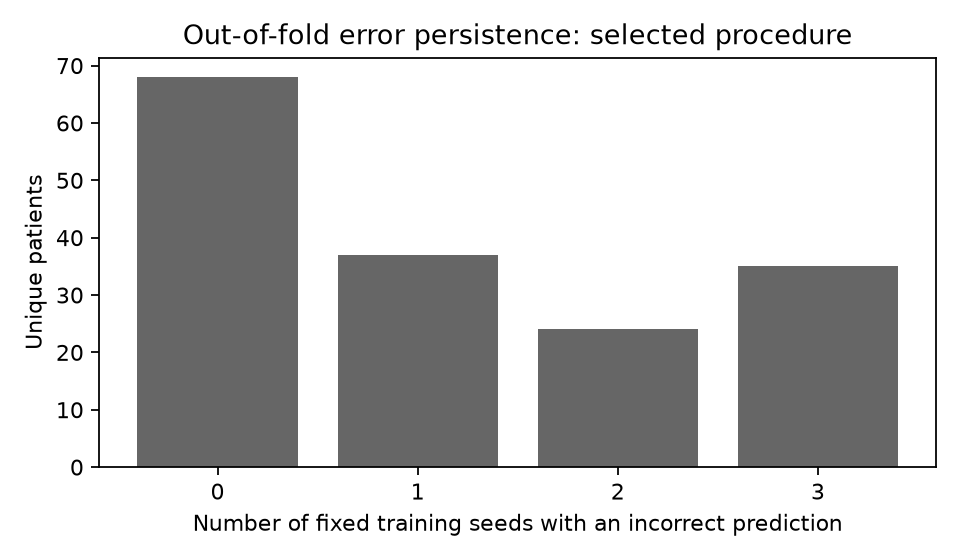
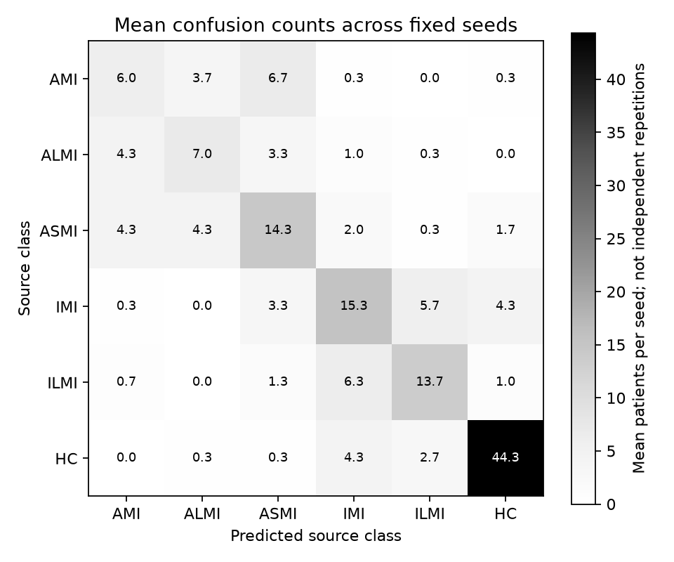

# Persistent patient-error audit

Completed out-of-fold predictions: 164 unchanged patients, 391 records, 55,863 original beats, seeds [42, 123, 2026].

The selected procedure misclassifies **35 patients in every seed**; the baseline has 36, with 27 persistent in both. These are model failures against source labels, not confirmed annotation mistakes.

## Class-stratified review flags

| Source class | Persistent | Other | Header disagreements (persistent/other) | Former location reported (persistent/other) | Median short-interval fraction (persistent/other) |
|---|---:|---:|---|---|---|
| AMI | 7 | 10 | 0/0 | 2/2 | 0.000/0.000 |
| ALMI | 5 | 11 | 0/0 | 0/1 | 0.000/0.000 |
| ASMI | 7 | 20 | 0/0 | 2/6 | 0.000/0.000 |
| IMI | 9 | 20 | 0/0 | 3/3 | 0.000/0.000 |
| ILMI | 5 | 18 | 0/0 | 2/3 | 0.000/0.000 |
| HC | 2 | 50 | 0/0 | 0/0 | 0.000/0.000 |

Fractions and denoising diagnostics are summarized at patient level. Class mix differs between persistent/other groups; pooled differences cannot identify causes. Small strata are descriptive, without significance tests or causal claims. Full class/group diagnostic medians are in `summary.json`.

The exact-byte raw XYZ screen found 0 cross-patient duplicate groups. This is not a near-duplicate or hidden-identity audit.

## Local review packet

`review/INDEX.md` links all 35 persistent cases. Plots show median cached beats from up to 3 recordings per patient, selected by record order, not waveform appearance. Cached R is a pipeline position, not independent ground truth. Per-patient predictions, source annotation text and diagnostics are local in `review/`. An unfilled review form is supplied for a qualified reviewer.

Header disagreement means disagreement with the parser/cache, not an adjudicated clinical error. Multiple acute text variants can be spelling variants. A reported former location is context, not permission to replace the acute label. Short/long cached intervals and neighboring-peak overlap are screening flags, not confirmed missed/false peaks. Low source-class probability is an uncalibrated model score and only orders review; no probability ensemble is evaluated.

No independent expert adjudication was supplied, and no patient, beat, label or cached R position was changed. The model-error-selected review cases are not a random cohort sample. This audit cannot establish label noise, diagnostic ambiguity, signal-quality causes or a dataset ceiling. Training-size subsets are generated independently from class labels/patient IDs and must not use these flags.
