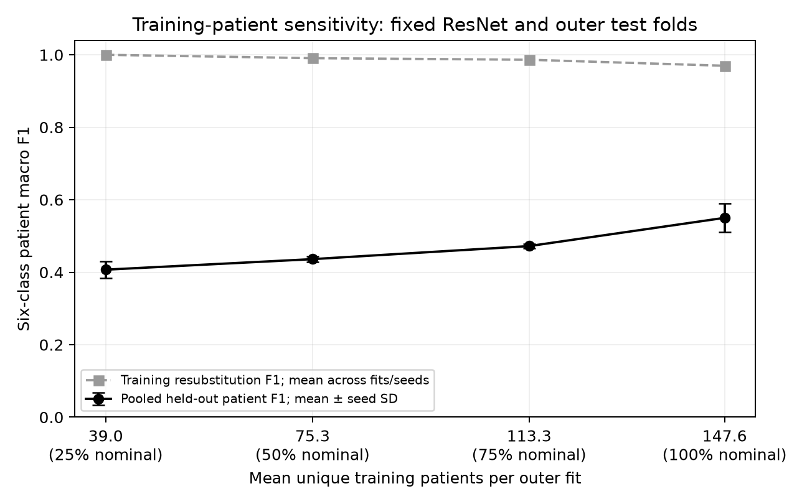

# Patient-training-size sensitivity

164 identical held-out patients, 391 records, 55,863 original beats; seeds [42, 123, 2026]; 10 frozen outer patient folds.

| Nominal per-class fraction | Actual training patients per fit, mean [range] | Held-out macro F1, mean ± seed SD | Mean training resubstitution F1 |
|---|---|---:|---:|
| 25% | 39.0 [38, 40] | 0.407 ± 0.024 | 1.000 |
| 50% | 75.3 [74, 76] | 0.436 ± 0.008 | 0.991 |
| 75% | 113.3 [112, 114] | 0.472 ± 0.006 | 0.986 |
| 100% | 147.6 [147, 148] | 0.550 ± 0.040 | 0.970 |

## Protocol

Every point is freshly trained, including 100%; no historical score is substituted. Class-stratified training-patient prefixes are nested across sizes, chosen by a separate fixed subset seed and class labels/IDs only, never error-audit flags. All beats of selected patients enter the eligible training pool. Per-class counts are rounded up, so actual patient counts differ from nominal percentages. All outer-test patients and beats remain identical across sizes.

Inner patient partitions are rebuilt within each selected subset using the same split-seed rule. Normalization and stopping use only that subset's inner-training/validation patients; excluded training-pool patients do not supply validation labels. At 100%, original inner memberships and model-seed rules are retained. Selected epoch budgets are rounded medians of inner best epochs; fresh outer-training refits never monitor outer-test results.

The original 651-sample denoised measured XYZ ResNet is unchanged. No augmentation, label changes, beat exclusions, new detector, ECG input or pretraining. All sizes have 8,192 class/patient-balanced beat presentations/epoch, batch size 128, up to 25 epochs and patience 6. Initial weights match across sizes; sampled rows, normalizers, stopping epochs and inner membership can differ. Total fresh fits: 480.

Training scores are resubstitution on all selected training patients after fitting, averaged across outer fits and then seeds. These repeatedly occurring training patients are not independent observations. Held-out scores are pooled out-of-fold patient macro F1, then averaged across fixed training seeds. These quantities describe different populations/averaging rules; their gap is not a formal bias/variance decomposition. Error bars show three-seed SD, not confidence intervals or training-subset variability.

## Paired held-out comparisons

| Comparison | Mean macro F1 difference | Descriptive paired patient interval |
|---|---:|---|
| 100% − 25% | +0.143 | [+0.073, +0.213] |
| 100% − 50% | +0.114 | [+0.054, +0.177] |
| 100% − 75% | +0.078 | [+0.028, +0.130] |

5,000 class-stratified patient draws shared across fractions/seeds in each comparison. Conditional on fitted predictions and fixed seeds; no refits, training-subset resampling, correction for shared training folds, repeated development or multiple comparisons.

## Mean held-out class F1 across seeds

| Class | 25% | 50% | 75% | 100% |
|---|---:|---:|---:|---:|
| AMI | 0.201 | 0.310 | 0.314 | 0.373 |
| ALMI | 0.273 | 0.241 | 0.272 | 0.436 |
| ASMI | 0.311 | 0.383 | 0.410 | 0.530 |
| IMI | 0.495 | 0.448 | 0.502 | 0.548 |
| ILMI | 0.394 | 0.401 | 0.485 | 0.576 |
| HC | 0.768 | 0.835 | 0.850 | 0.837 |

## Interpretation boundaries

Only one nested subset realization per outer fold is used, shared across training seeds. Small class counts make inner stopping noisy. Equal presentations/epoch expose fewer-patient subsets to more repeats per patient, while larger subsets have fewer repeats; a flat or rising curve applies to this fixed model and compute policy. Do not extrapolate a target score, sample-size requirement, physiological cause or PTB performance ceiling. Repeatedly inspected PTB folds are development data, not independent confirmation. MPS is not guaranteed bitwise deterministic.

Persistent-error flags do not alter subsets, labels or patient eligibility. No unplanned ensemble or best fraction/seed is selected for a new claimed result. Existing studies and PTB-XL tests are unchanged. Waveforms, weights and individual training/test probabilities remain local. This graph is a diagnostic, not a model-selection sweep.

Method background: [scikit-learn learning-curve documentation](https://scikit-learn.org/stable/modules/learning_curve.html). This implementation uses explicit patient groups and inner stopping rather than beat-level default learning-curve splits.
