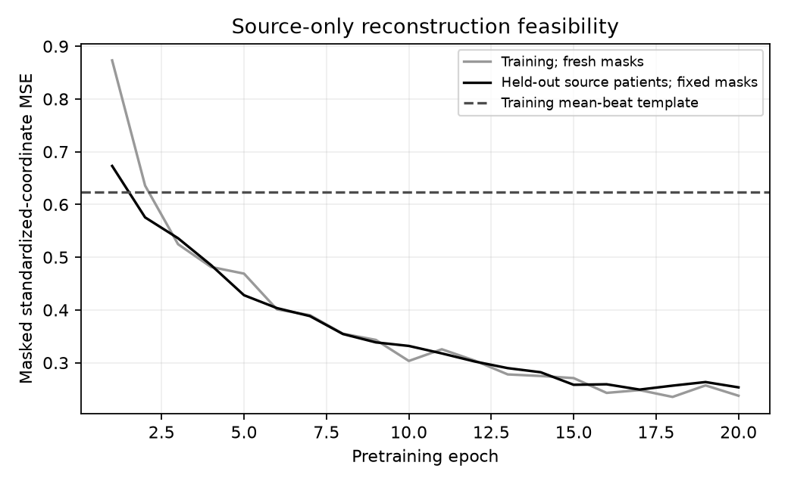

# Source-only masked-XYZ pretraining pilot

1,024 unique PTB-XL training patients; 128 disjoint source validation patients. One 651-sample Kors-derived XYZ crop per retained patient. No diagnostic labels used.

Best fixed-mask validation MSE: **0.24910**, epoch 17; 20 epochs completed.

| Validation predictor | Masked MSE |
|---|---:|
| Pretrained encoder + reconstruction decoder | 0.24910 |
| Training mean-beat template | 0.62411 |
| Zero predictor (training lead means) | 0.96967 |
| Trained model with all-zero input | 1.43111 |

6 of 21 contiguous 31-sample time patches are masked jointly across XYZ (28.57% of time). Masks are fresh during training; validation masks are fixed for the entire run. Input is zeroed in training-standardized units, and MSE is computed only on masked coordinates. Source normalization and mean-beat template use training patients only.

The encoder reuses the existing ResNet encoder (77,808 parameters); a temporary linear decoder adds 126,945 parameters. The decoder is not part of a future target classifier. Every epoch samples 4,096 source training patients with replacement. This creates additional masked views, not additional independent patients.

Checkpoints preserve model, optimizer, best state and sampler/mask/loader/torch RNG states. Compatible interruptions resume; MPS is not guaranteed bitwise deterministic. The local encoder-only export is architecture-compatible with the existing VCG ResNet, but carries an explicit unresolved cross-dataset identity flag.

## What this result permits

This measures source-only reconstruction feasibility against simple baselines. A lower MSE may reflect learning an aligned average waveform; the training-template and zero-input controls help expose that limitation. Even a good reconstruction result does not establish useful localization features or downstream transfer benefit. One seed, one selected crop/patient and one validation mask realization are used.

No PTB target labels, folds, waveforms or predictions enter this pilot. No PTB localization score is reported. PTB-versus-PTB-XL patient identity overlap and comprehensive aligned waveform-overlap screening remain unresolved, so the export is not cleared for a clean patient-independent target claim. The next step must address that provenance limitation and then run a separately declared matched transfer comparison. No clinical, 0.80–0.90 F1 or SOTA claim is made.
