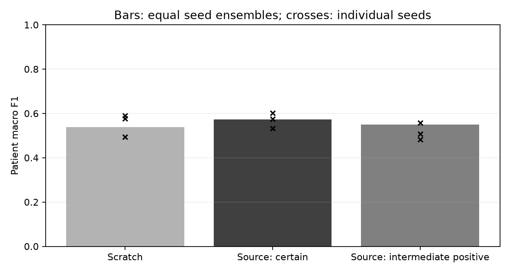

# Matched supervised-source transfer to measured Frank VCG

Exploratory measured-VCG PTB development; source-target patient identity remains unresolved; no independent confirmation, clinical validity or SOTA claim.

164 target patients, 391 recordings and 55,863 original beats; 10 frozen outer folds, 3 inner folds, target seeds [42, 123, 2026]. Both source objectives use the same single source training seed 42; target restarts are not independent source pretraining replications.

| Procedure | Mean seed macro F1 ± sample SD | Equal-probability seed ensemble macro F1 |
|---|---:|---:|
| scratch | 0.553331 ± 0.051880 | 0.538736 |
| source_certain | 0.569351 ± 0.035333 | 0.573361 |
| source_positive_intermediate | 0.514954 ± 0.038236 | 0.549364 |

## Prespecified comparisons

source_certain−scratch ensemble difference **+0.034625**, descriptive paired patient-bootstrap interval **[-0.046511,+0.113800]**.
source_positive_intermediate−scratch ensemble difference **+0.010628**, descriptive paired patient-bootstrap interval **[-0.059197,+0.078868]**.

The certain source is the primary comparison; intermediate-positive is sensitivity. Both and all target seeds are retained, without choosing a source objective, seed subset or ensemble weights from outer scores. Mean member F1 and probability-ensemble F1 are different endpoints. The historical neural ensemble0.584570 and full-feature ridge0.584266 remain separate development references, not newly trained matched controls.

## Ensemble class results

| Class | Target patients | Scratch F1 | Certain-source F1 | Intermediate-source F1 |
|---|---:|---:|---:|---:|
| AMI | 17 | 0.333333 | 0.285714 | 0.344828 |
| ALMI | 16 | 0.457143 | 0.486486 | 0.500000 |
| ASMI | 27 | 0.566038 | 0.581818 | 0.500000 |
| IMI | 29 | 0.482759 | 0.500000 | 0.470588 |
| ILMI | 23 | 0.533333 | 0.690909 | 0.615385 |
| HC | 52 | 0.859813 | 0.895238 | 0.865385 |

## Training and independent verification

All **630** declared fits were restored: **90 outer models**, remaining fits from every inner rate/partition/seed/arm. All **210 matched context checks** passed. Every saved model is re-inferred on its exact query rows; inner best-checkpoint F1 is reproduced, every learning-rate/epoch choice is repeated from inner scores, and outer test patients never set stopping or normalization. Model/prediction/selection hashes and source/provenance scopes are checked.

The existing same ResNet/CE/AdamW trainer is used for all arms. Only the declared source encoder weights transfer; the source diagnostic head, normalization, optimizer and positive-loss weights are discarded. Every target classifier is freshly initialized with matching paired weights. Target normalization is refitted within each target training partition, using the same class/patient weights; no per-beat unit-amplitude normalization or rotation is introduced. Full encoders fine-tune in both source arms.

All procedures share the target learning-rate candidates [0.001, 0.0001], batch128, 8,192 sampled beats/epoch, at most25 epochs and patience6. Matching initial heads, sample sequences for shared epochs, normalization, parameter counts and memberships are checked. Early-stopped durations and separately inner-selected settings can differ. Rate ties use configured order; refit epochs are the rounded median of the chosen candidate's best inner epochs. Outer refits receive no validation/test monitoring. Completed-fit resume is supported; interrupting an unfinished fit repeats that fit. Source pretraining adds compute beyond the equal target budgets.

All held-out original beat probabilities are averaged per patient. Uniform probability averaging across all three target seeds is prespecified per procedure; no learned combiner, seed selection, threshold tuning or source-target class-label mapping is fitted. Native source overlapping diagnoses and the source NORM definition do not relabel target classes.

## Provenance and interpretation limits

Both supervised source models and the expanded recording audit were independently verified before launch. The expanded screen covers 7246 source training/validation recordings against 391 target recordings, with 57968 retrieved continuous comparisons and 20/20 known-copy controls. Its passed recording flag does not resolve different visits by the same person, shorter/modified copies, retrieval misses or clinical source-target equivalence. No target patients were deleted or relabeled.

This is repeatedly inspected PTB development data, with ECG-derived source XYZ versus measured Frank target XYZ. The paired bootstrap resamples each patient once per draw, shared across fixed predictions/arms/seeds. It does not refit models, resample source pretraining, correct correlated training folds/repeated development/multiple comparisons, or establish independent confirmation, clinical validity, SOTA or a guaranteed0.80–0.90 result. Full-record preprocessing is offline/noncausal; seeded MPS is not bitwise-deterministic training.

Raw source/target files, models, fit-level query predictions and patient probabilities stay local in ignored review/data locations; public results contain aggregate metrics and hashed provenance. No subsequent experiment is launched.

Protocol: [matched supervised transfer](../../../docs/supervised_transfer_plan.md). Source evidence: [pilot](../../supervised_source_pilot_v1/REPORT.md), [expanded overlap audit](../../supervised_source_overlap_v1/REPORT.md).
