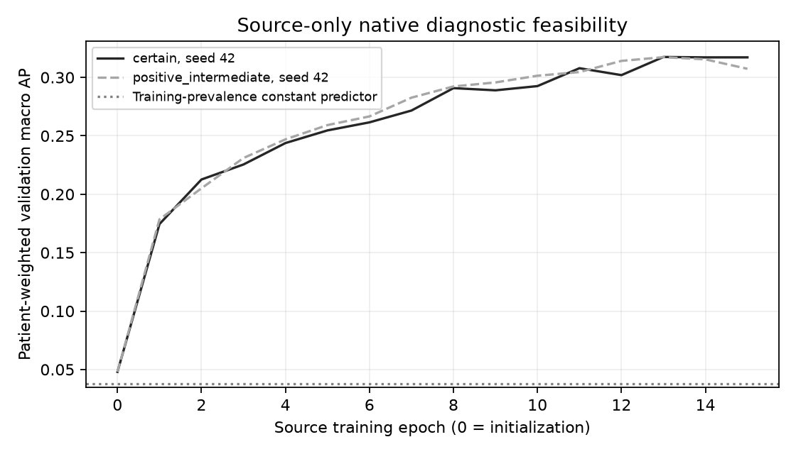

# Supervised native-annotation source pilot

Completed source-only training and restored-checkpoint verification. This is multilabel diagnostic learning on ECG-derived XYZ, not the six-class measured-VCG localization endpoint. No target training/evaluation or follow-on transfer was launched.

Selected 4,096 training patients / 5,063 records, including all 1,841 native training patients with at least one likelihood100 review MI code. Fill patients were sampled deterministically without validation labels. All selected visits were retained before QC. Full native fold9 validation: 1,942 patients / 2,183 records. Fold10 was excluded before label/signal access.

| Role | Retained patients | Retained records |
|---|---:|---:|
| train | 4096 | 5063 |
| validation | 1942 | 2183 |

QC/exact-copy exclusions: `{}`. Detected exact duplicate groups: 0 (raw-encoded and physical-XYZ grouping may overlap). Every cross-patient group member is quarantined; same-patient copies retain the lowest recording ID. No near-copy screen, clinical signal-quality adjudication or cross-dataset identity clearance is claimed.

Training heads: 28 native codes with at least 20 distinct retained training patients at likelihood100. Labels: NDT, NST_, LNGQT, NORM, IMI, ASMI, LVH, LAFB, ISC_, IRBBB, 1AVB, IVCD, ISCAL, CRBBB, CLBBB, ILMI, LAO/LAE, AMI, ALMI, ISCIN, INJAS, LMI, ISCIL, LPFB, ISCAS, INJAL, ISCLA, ILBBB. Validation support never chooses heads. Native normal ECG (NORM) is not automatically the target clinical HC definition; broad AMI parents are not the exclusive target AMI class.

## Declared annotation objectives

Both objectives treat unlisted codes as annotation negatives for this research benchmark. This is a declared supervision assumption, not adjudicated disease absence. Listed likelihood0 is unknown and masked in both. The primary certain objective trains only listed100 positives plus unlisted negatives, masking intermediate annotations. The positive_intermediate sensitivity also treats listed intermediate annotations as positive; likelihood values are not calibrated soft probabilities. Both arms use identical common validation masks: listed100 positives and unlisted annotation negatives; unknown/intermediate entries are excluded.

The primary source selection metric is patient-weighted record macro average precision (AP). Records carry weight 1/(retained records for that patient); labels remain record-specific, with no union across visits. Codes without both positive and negative validation records are reported but omitted from macro metrics. F1 uses a fixed 0.5 threshold, with no validation threshold search. This source F1 is not the project six-class patient macro F1.

| Objective | Seed | Best epoch / trained epochs | Macro AP | Macro AUROC | Macro F1 at 0.5 | Evaluable / trained codes |
|---|---:|---:|---:|---:|---:|---:|
| certain | 42 | 13 / 15 | 0.317456 | 0.908703 | 0.290552 | 28 / 28 |
| positive_intermediate | 42 | 13 / 15 | 0.317306 | 0.906510 | 0.287006 | 28 / 28 |

Training-prevalence constant baseline: macro AP 0.037470, AUROC 0.500000, F1@0.5 0.000000. Each run also reports its random-initialization control in summary.json. Both objectives and all declared seeds are retained; no winner replaces the declared comparison.

## Representation, fitting and verification

Each recording is transformed from standard 12-lead ECG to signed Kors XYZ, polyphase-resampled 500→1000Hz, denoised with existing bior6.8 settings, and represented by up to 4 uniformly spaced complete detector-centered 651-sample crops. Fewer crops use explicit padding masks. Detector positions and infarct boundaries are not expert-adjudicated. The existing small VCG ResNet encoder is shared across crops; their features are averaged within the recording before a native multilabel head. This is weak record-level supervision, not beat-level clinical labels or a new temporal architecture.

Normalization uses only training crops, giving each patient equal total record weight and each record equal crop weight. Patient-uniform record sampling uses 4,096 presentations per epoch with replacement. Positive loss weights come only from training annotations, capped at 20.0. AdamW, gradient clipping, at most 15 epochs, patience 4, and epoch-zero fallback were declared before training. The same initialization/sampler policy is used across the two objectives for each seed. Best checkpoints use common validation AP, so this validation is model-selection data, not independent confirmation. MPS is seeded but not guaranteed bitwise deterministic.

Checkpoint, optimizer, best state and sampler/loader/torch/device RNG states permit compatible interruption recovery. Each completed member is restored and its full validation probabilities recomputed, alongside scopes, normalization and file hashes. Local encoder exports carry explicit source-only and unresolved-identity flags. Private weights, source record labels, crop caches and recording predictions remain ignored; aggregate metrics/history and manifests are public.

## Interpretation and stopping boundary

Diagnostic source learning can establish whether the signal contains learnable native annotations under the declared convention. It does not demonstrate improved PTB localization, clinical validity, clean patient-independent cross-dataset transfer, a 0.80–0.90 target score or SOTA. Training enrichment changes source prevalence; the full validation fold retains its native prevalence. One declared training seed is a bounded feasibility check, not repeatability evidence.

Stop here. A later part must separately specify source waveform/provenance overlap checks and matched scratch-versus-supervised-pretrained target evaluation inside the existing patient partitions. The original 164-patient target and frozen ridge/neural development references are unchanged.

Protocol: [supervised source pilot](../../docs/supervised_source_pilot_plan.md). Source documentation: [PTB-XL1.0.3](https://physionet.org/content/ptb-xl/1.0.3/).
